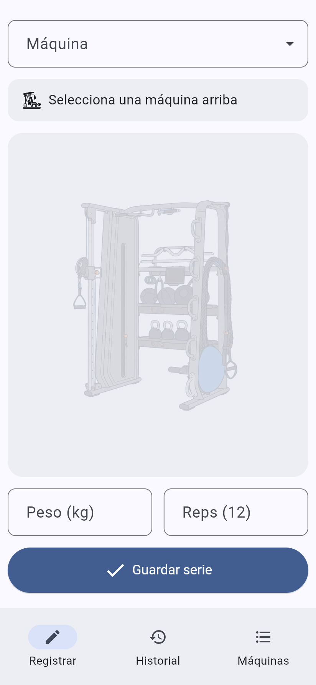
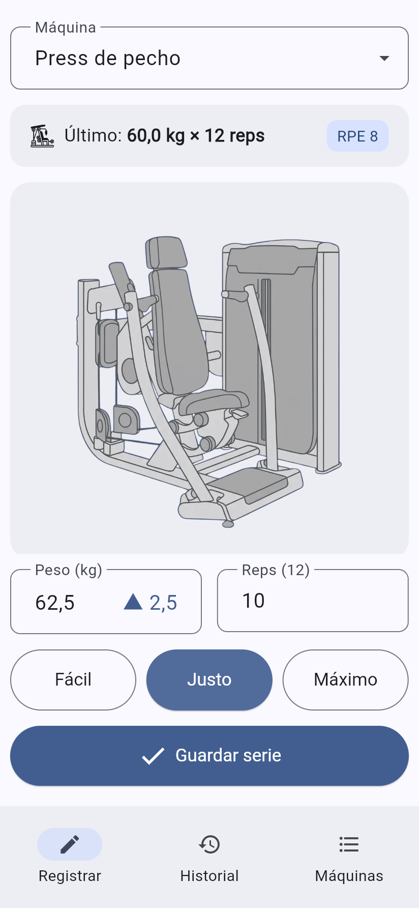
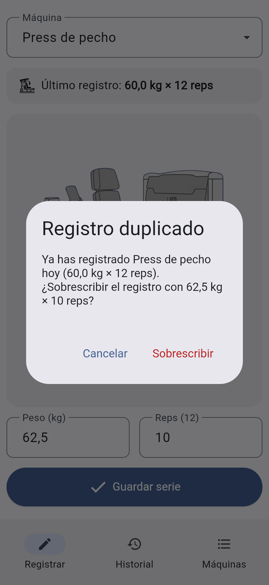
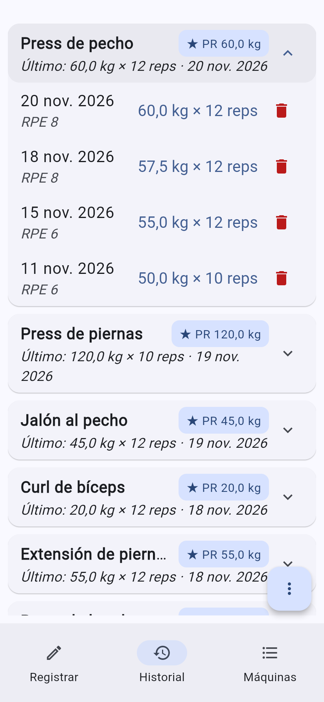
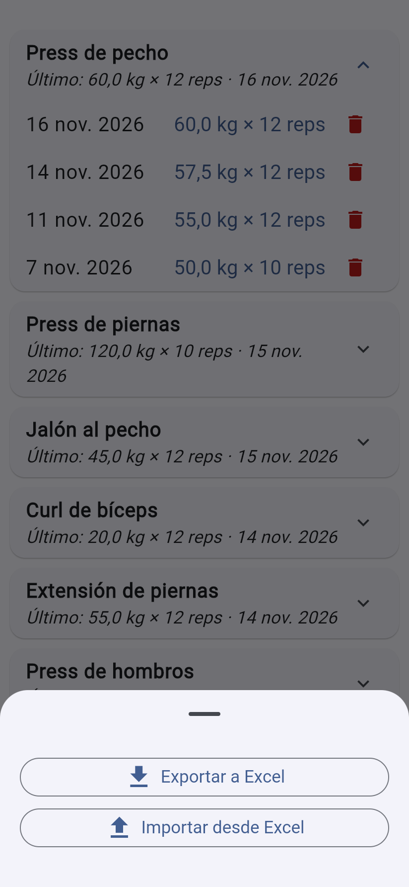
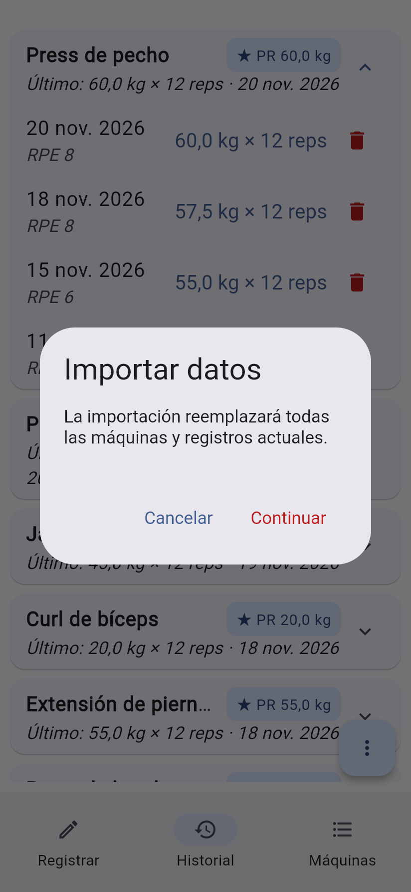
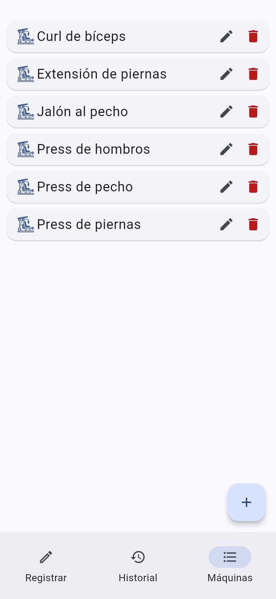
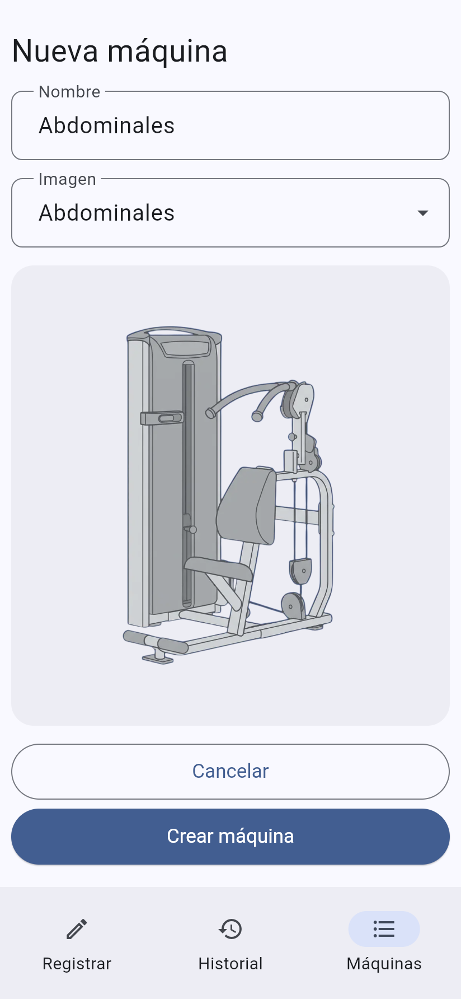
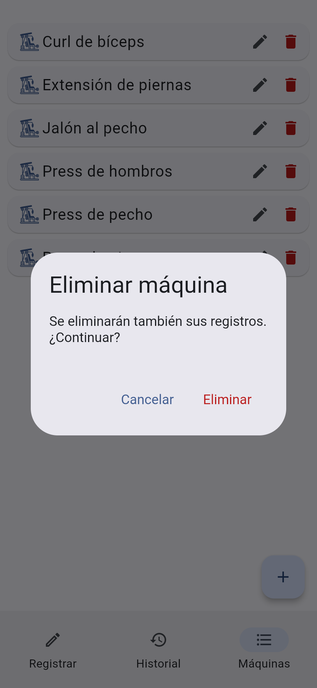
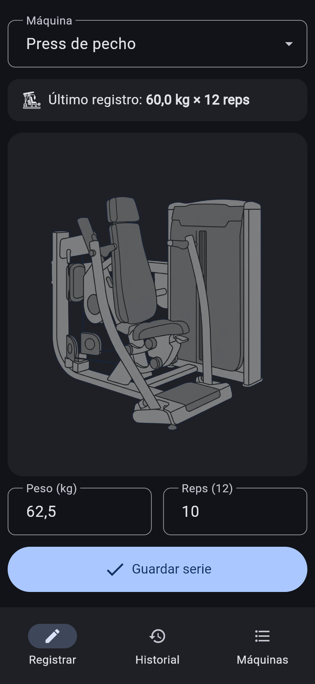

# Manual de usuario

Mi Gimnasio sirve para apuntar, máquina a máquina, el peso y las repeticiones de
cada entrenamiento. Todo se guarda en el propio dispositivo, la app está pensada
para usarse en el gimnasio y los textos y controles son grandes para poder
tocarlos con una mano y con prisa.

En este manual se explican las tres pestañas, cómo registrar una serie, cómo
consultar y borrar el historial, cómo gestionar las máquinas y cómo hacer copias
de seguridad en Excel.

> Las imágenes están tomadas de la app funcionando con datos de ejemplo.

## Índice

1. [Abrir la app](#1-abrir-la-app)
2. [La pantalla principal](#2-la-pantalla-principal)
3. [Registrar una serie](#3-registrar-una-serie)
4. [Historial](#4-historial)
5. [Exportar e importar en Excel](#5-exportar-e-importar-en-excel)
6. [Máquinas](#6-máquinas)
7. [Tema claro y oscuro](#7-tema-claro-y-oscuro)
8. [Dónde se guardan los datos](#8-dónde-se-guardan-los-datos)
9. [Preguntas frecuentes](#9-preguntas-frecuentes)

## 1. Abrir la app

Hay tres formas de abrirla, y en las tres los datos se guardan en el mismo sitio
del dispositivo, así que puedes cambiar de una a otra sin perder nada.

- **AppImage (Linux)**: descarga el archivo `gymtracker-<versión>-x86_64.AppImage`,
  dale permiso de ejecución y ábrelo:

  ```bash
  chmod +x gymtracker-<versión>-x86_64.AppImage
  ./gymtracker-<versión>-x86_64.AppImage
  ```

- **Android**: instala la APK del dispositivo (`arm64-v8a` en la mayoría de los
  móviles actuales).
- **Web**: con el proyecto descargado, ejecuta `python main.py` y abre
  `http://localhost:8550`.

La app acepta dos parámetros opcionales al abrirla, también en el AppImage:

| Parámetro | Valores | Por defecto |
|---|---|---|
| `--theme` | `system`, `light`, `dark` | `system` (sigue al sistema) |
| `--size` | `pixel-7-pro`, `pixel-10` | `540x960` |

```bash
./gymtracker-<versión>-x86_64.AppImage --theme dark --size "Pixel 7 Pro"
```

`--size` solo cambia el tamaño inicial de la ventana en el escritorio; después
se puede redimensionar como cualquier otra ventana.

## 2. La pantalla principal

La app tiene una barra inferior con tres pestañas y no tiene barra de título: el
nombre de la pestaña seleccionada ya indica dónde estás.

| Pestaña | Para qué sirve |
|---|---|
| **Registrar** | Elegir la máquina, ver su último registro y guardar la serie de hoy. |
| **Historial** | Consultar los registros agrupados por máquina, borrar uno y abrir las opciones de Excel. |
| **Máquinas** | Crear, editar y eliminar máquinas, con su imagen. |

Las pestañas **Historial** y **Máquinas** muestran un botón flotante en la
esquina inferior derecha: en Historial abre las opciones de Excel y en Máquinas
crea una máquina nueva.

<p align="center">

</p>

## 3. Registrar una serie

Es el uso normal de la app: llegas a la máquina, apuntas lo que has hecho y
sigues con la siguiente.

1. **Elige la máquina** en el desplegable **Máquina**, en la parte de arriba.
   También puedes deslizar la imagen grande hacia los lados: cada deslizamiento
   pasa a la máquina anterior o siguiente de la lista, y da la vuelta al llegar
   al final.
2. **Mira el último registro** de esa máquina, que aparece bajo el desplegable
   (`Último registro: 60,0 kg × 12 reps`). Es la referencia para saber con cuánto
   acabaste la última vez.
3. **Escribe el peso** en **Peso (kg)**. Se admite la coma para los decimales
   (`62,5`); el punto no, porque en español el decimal se escribe con coma. El
   peso tiene que ser mayor que 0 y como mucho 1000 kg.
4. **Escribe las repeticiones** en **Reps (12)**. Es un número entero entre 1 y
   999. El `(12)` del nombre del campo es el valor por defecto: si lo dejas
   vacío, la serie se guarda con 12 repeticiones.
5. **Pulsa Guardar serie**. La app confirma con un aviso y la pestaña se limpia,
   lista para la siguiente máquina.

<p align="center">

</p>

### Un solo registro por máquina y día

Solo puede haber un registro de cada máquina en cada día: la app está pensada
para usarse en el gimnasio, así que cada serie se guarda con la fecha de hoy y no
se pueden apuntar entrenamientos pasados.

Si ya has registrado esa máquina hoy y vuelves a guardar, la app te avisa de lo
que hay guardado y de lo que vas a poner. Si aceptas, **sobrescribe** el peso y
las repeticiones de hoy en lugar de crear un registro duplicado; si cancelas, no
cambia nada.

<p align="center">

</p>

## 4. Historial

La pestaña **Historial** agrupa los registros por máquina, con la máquina del
registro más reciente arriba y, en cada una, sus registros del más nuevo al más
antiguo.

- **Toca una máquina** para desplegar sus registros. Cada uno muestra la fecha y
  la serie, por ejemplo `60,0 kg × 12 reps`.
- **Toca el icono de la papelera** de un registro para borrarlo. La app pide
  confirmación antes de eliminarlo.
- El resumen de cada tarjeta (`Último: … · 16 nov. 2026`) indica la serie y la
  fecha más recientes.

<p align="center">

</p>

### Borrar un registro

El borrado es definitivo y no se puede deshacer, así que la app siempre muestra
un diálogo de confirmación con las opciones **Cancelar** y **Eliminar**.

## 5. Exportar e importar en Excel

El botón flotante de la pestaña **Historial** abre las dos acciones de Excel.

<p align="center">

</p>

### Exportar

**Exportar a Excel** genera un archivo `historial_gimnasio.xlsx` con una fila por
registro y las columnas `Fecha`, `Máquina`, `Peso (kg)`, `Repeticiones` e
`Imagen`. La última guarda el dibujo que tiene cada máquina, así que al importar
el archivo se recuperan también las imágenes. El
navegador o el sistema piden dónde guardarlo; si cancelas ese diálogo, no se
escribe ningún archivo.

Es la forma recomendada de hacer una copia de seguridad antes de cambiar de
dispositivo o de reinstalar la app.

### Importar

**Importar desde Excel** lee un archivo con esas mismas columnas y **sustituye
por completo** las máquinas y los registros que tengas en la app. No se fusiona
con lo que ya hay: lo que no esté en el archivo desaparece.

Por eso la app avisa antes de continuar:

<p align="center">

</p>

- También acepta archivos antiguos de tres columnas (`Fecha`, `Máquina`,
  `Peso (kg)`); en ese caso se asignan 12 repeticiones a cada serie.
- Los archivos sin columna `Imagen` (exportados antes de 3.0.0) siguen
  importándose: el dibujo de cada máquina se deduce de su nombre.
- Si el archivo trae varias filas de la misma máquina y fecha, se queda con la
  última.
- Al terminar, la app muestra cuántas máquinas y cuántos registros se han
  importado, o el motivo del error si el archivo no es válido.

## 6. Máquinas

La pestaña **Máquinas** lista todas las máquinas. En cada fila hay dos acciones:
el lápiz para **editar** el nombre y la imagen, y la papelera para **eliminar** la
máquina.

<p align="center">

</p>

### Crear una máquina

El botón **+** abre el formulario de creación, que sustituye a la lista mientras
está abierto.

1. **Escribe el nombre.** Si coincide con una de las máquinas que la app conoce,
   se elige sola la imagen correspondiente.
2. **Cambia la imagen si quieres** en el desplegable **Imagen**. Puedes elegir
   cualquier dibujo del catálogo o **Sin imagen**, y también deslizar la imagen
   hacia los lados para pasar de una a otra.
3. **Pulsa Crear máquina**. **Cancelar** descarta el formulario; en Android, el
   gesto de volver también lo cierra sin salir de la app.

<p align="center">

</p>

Si el nombre no se parece a ninguna máquina conocida, no pasa nada: la máquina se
crea igualmente con **Sin imagen** y siempre puedes asignarle una después.

### Editar el nombre o la imagen

El lápiz de una fila abre el mismo formulario con los datos de esa máquina
cargados. Guardar los cambios es inmediato y afecta a todos sus registros, porque
el historial se agrupa por máquina, no por registro: renombrar una máquina
renombra también su historial.

### Eliminar una máquina

La papelera pide confirmación y avisa de lo importante: **se eliminan también
todos los registros de esa máquina**. Si solo quieres dejar de usarla, no hace
falta borrarla.

<p align="center">

</p>

## 7. Tema claro y oscuro

Por defecto la app sigue el tema del sistema, así que cambia a oscuro cuando el
móvil o el escritorio cambian. Los dibujos de las máquinas se atenúan en el tema
oscuro para no destacar sobre el fondo.

Si prefieres fijarlo, abre la app con `--theme light` o `--theme dark`. Con
`--theme system`, o sin parámetro, vuelve a seguir al sistema.

<p align="center">

</p>

## 8. Dónde se guardan los datos

- Todo se guarda en un archivo SQLite llamado `gym.db`, que se crea en el primer
  arranque en la carpeta de datos del dispositivo. No hay cuentas, ni nube, ni
  conexión a internet.
- Cada serie guarda la fecha del día en que se registra.
- **Exportar a Excel es la copia de seguridad**: si desinstalas la app o cambias
  de móvil, el Excel te permite recuperar los datos con **Importar desde Excel**.
- Antes de importar, exporta lo que tengas: la importación reemplaza todo.

## 9. Preguntas frecuentes

**El peso no me deja escribir la coma… o el punto.**

La app acepta la coma (`62,5`) y rechaza el punto (`62.5`). Al cambiar el valor,
el aviso desaparece.

**He dejado las repeticiones vacías y se han guardado 12.**

Es lo previsto: 12 es el valor por defecto del campo, pensado para no tener que
escribirlo en cada serie.

**Dice «Sin registros previos».**

Esa máquina todavía no tiene ninguna serie guardada. Elige otra o guarda la
primera.

**He guardado y no aparece un registro nuevo, me ha preguntado si sobrescribir.**

Ya había un registro de esa máquina hoy: solo se admite uno por máquina y día, así
que la app actualiza el peso y las repeticiones en lugar de duplicarlo.

**La imagen de la máquina no aparece en la lista.**

La app sugiere una imagen cuando reconoce el nombre. Si no lo reconoce, la máquina
se crea con **Sin imagen**; abre el lápiz y elige una a mano en el desplegable.

**¿Puedo apuntar un entrenamiento de ayer?**

No. Los registros se guardan siempre con la fecha de hoy. El historial sirve para
consultar lo ya apuntado, no para rellenar días pasados.

**He importado un Excel y ha desaparecido lo que tenía.**

La importación sustituye todas las máquinas y registros. Si no querías eso,
restaura el Excel exportado justo antes de importar.
